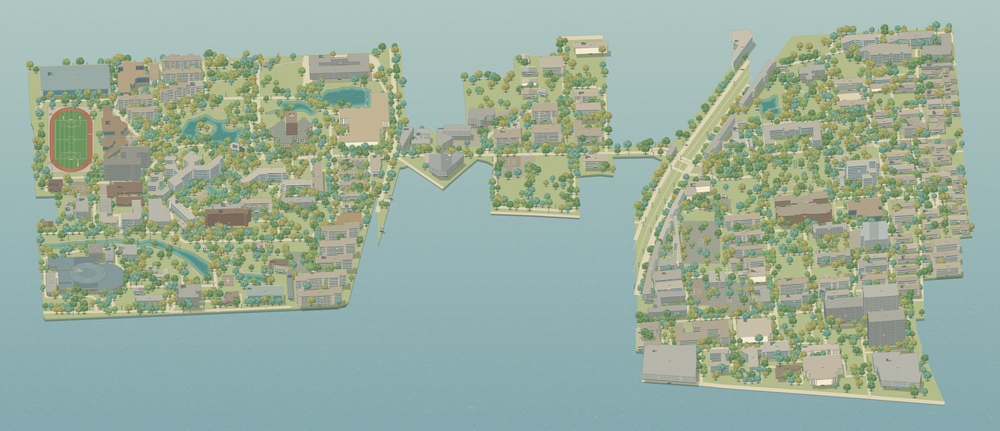
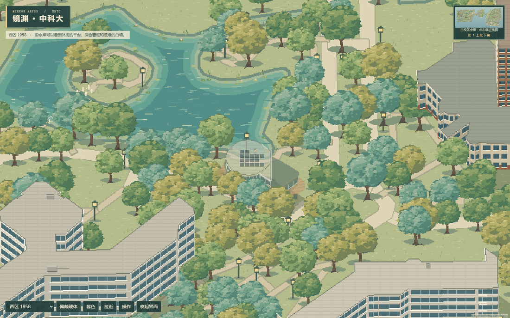
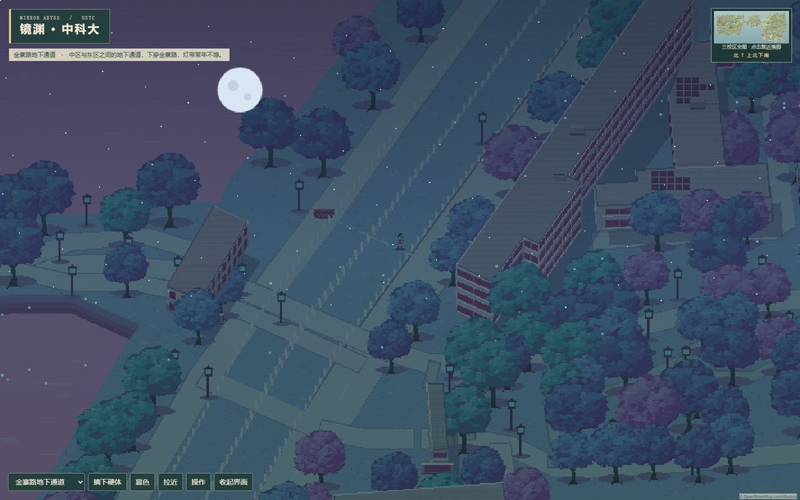

# 镜渊 · 中科大（MAIES）

以中国科学技术大学西区、中区、东区为原型的 **2.5D 像素开放世界**地图与漫游原型。
一枚“硬体”（项圈 / 发箍 / 发卡）戴上，校园就变成「镜渊」；摘下，它又是现实里的中科大。

- 一张连续大地图：**6754 × 2913**，三校区由肥西路与金寨路地下通道相连
- **现实 / 镜渊** 两套观感，随时一键切换
- 纯离线：贴图、角色、逻辑全部内嵌在一个 HTML 里
- 数据来自 OpenStreetMap，建筑按功能分型建模，可复现、可增量修改



## 现在就能玩

```bash
git clone https://github.com/qianxialeo/maies-ustc.git
cd maies-ustc
python -m pip install -r requirements.txt
python scripts/build.py --serve      # 构建并打开 http://127.0.0.1:8000
```

不想装 Python？直接下载 CI 产物或 Releases 里的 zip，解压打开 `中科大像素漫游.html` 即可。

| 操作 | 键位 |
| --- | --- |
| 行走 | 方向键 / WASD，Shift 快走 |
| 直走 | 点击地面 |
| 切换现实 / 镜渊 | **M** 或底部“佩戴硬体”按钮 |
| 跳转地标 | 左下角下拉菜单（14 个）/ 点击小地图 |
| 日光 / 暮色 | 底部“暮色” |
| 缩放 | 底部“拉近” |




## 目录结构

```
.
├── data/                 # 原始 OSM 数据（ODbL），campus3.osm 为三校区主数据
├── source/
│   ├── make.py           # 核心：OSM -> 地面图层 + 物件 + 通行掩码 + 地标
│   ├── bundle.py         # 把图层与物件打包成离线 HTML / 全图 PNG
│   ├── game.html         # 游戏外壳：移动、相机、遮挡排序、镜渊模式
│   └── make_v1_iso.py    # 旧版等轴测生成器（存档用）
├── scripts/              # build / serve / package / fetch_osm
├── docs/                 # 架构、美术规范、路线图、数据与授权
├── art/                  # 构建产物（不入库）
└── .github/              # CI、Pages、Issue/PR 模板、CODEOWNERS
```

构建产物：`art/`（ground.png / nav.png / scene.json）、`中科大像素漫游.html`、`中科大全图.png`、`West-Lakeside.png`。
**这些都不要提交**，`.gitignore` 已忽略，CI 会重新生成。

## 技术管线

```
data/campus3.osm
      │  （投影：正北向上，东西 3.1 px/m，南北 ×0.78，立面 ×1.16 ≈ 51° 俯角）
      ▼
source/make.py ──► art/ground.png  地面层（草地/道路/水系/田径场/球场/墙基/阴影）
               ├─► art/nav.png     1bit 通行掩码（含斑马线与地下通道）
               └─► art/scene.json  物件表（建筑/树/灯/灯塔…，含遮挡排序值）+ 地标
      ▼
source/bundle.py ──► 中科大像素漫游.html（内嵌全部 PNG 与 scene.json）
                  └► 中科大全图.png / West-Lakeside.png
```

细节见 [docs/architecture.md](docs/architecture.md)，美术规范见 [docs/art-style.md](docs/art-style.md)。

## 世界观

项目基于原创设定《镜渊（Mirror Abyss Immersive Environment Simulator）》：
戴上硬体即可进入一个没有任务栏、只用来“走一走、看一看”的沉浸世界。
系统只传递视、听、触等感官信号，屏蔽痛觉；因此这里没有战斗与死亡，只有探索、偶遇与对话。

游戏内的两位主要角色——18 岁的学妹**小茉**与 21 岁的学姐**小橘**——尚未落进地图，
见 [路线图](docs/roadmap.md)。

## 数据与授权

- 地理数据：© OpenStreetMap contributors，**ODbL 1.0**。
- 代码：**MIT**。
- 像素美术：**CC BY-SA 4.0**。
- 设定文本：© 项目作者，保留权利。

完整说明见 [LICENSES.md](LICENSES.md) 与 [docs/data-and-licenses.md](docs/data-and-licenses.md)。
任何公开分发都必须保留地图右下角的 OSM 署名。

## 路线图

- [x] 西区 2.5D 地图与田径场精细贴图
- [x] 北上斜俯视、建筑分型与非同质化配色
- [x] 三校区连通（肥西路斑马线 / 金寨路地下通道）
- [x] 现实 / 镜渊双版本切换
- [ ] 小茉、小橘作为可对话 NPC 入场
- [ ] 镜渊专属景观：空中岛屿、月面广场、可进入的“场景”
- [ ] 存档、图鉴、随身听（BGM/环境音）
- [ ] 移动端与手柄适配

## 参与贡献

欢迎提交 Issue 与 PR。开始之前请读 [CONTRIBUTING.md](CONTRIBUTING.md)：
分支命名、提交信息、评审流程、以及“不要提交生成物”的规矩都写在那里。

```bash
git switch -c feat/xiaomo-npc
# 改 source/game.html 或 source/make.py
make check && make build
git commit -m "feat(npc): 加入小茉的对话触发"
```
